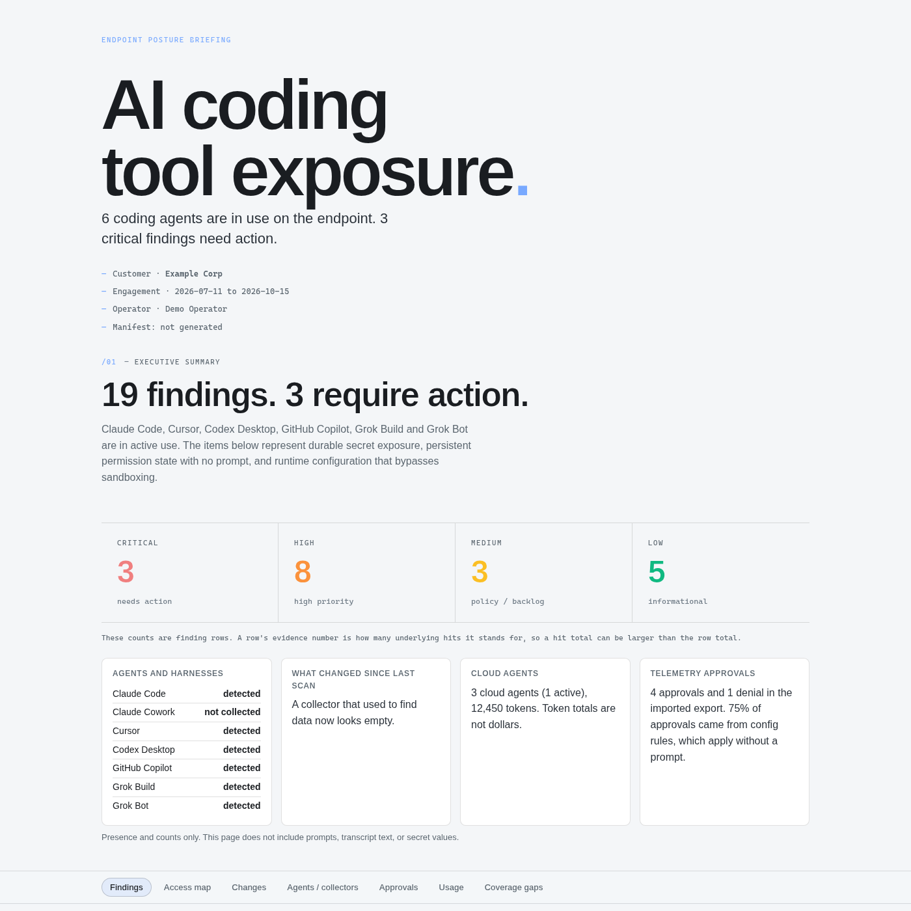

# ai-agent-audit (aiscan)

aiscan is an offline Windows scanner that shows what AI coding agents can
reach and do on a machine. One command inventories what Claude Code, Claude
Cowork, Cursor, Codex, GitHub Copilot, Grok Build and Grok Bot are allowed to
do, what chat history they keep locally, and where secrets may have landed.
The output is an evidence layer with no raw transcripts and no identifying
filesystem paths, plus a one-file HTML briefing.

Current release: **[v0.2.0](https://github.com/robrounsavall/ai-agent-audit/releases/tag/v0.2.0)**
(2026-10-15). What changed in each release is in [CHANGELOG.md](CHANGELOG.md).

[](https://robrounsavall.github.io/ai-agent-audit/sample-report.html)

The screenshot and the
[sample report](https://robrounsavall.github.io/ai-agent-audit/sample-report.html)
are built from synthetic data, not a real machine. The briefing opens with a
summary, then tabs for findings, the access map, what changed since the last
scan, agent and collector detail, telemetry approvals, usage, and coverage
gaps. See [docs/report-v2.md](docs/report-v2.md).

## Quick start

You need Windows 10/11, PowerShell 5.1+ and Python 3.11+ on PATH. See
[Prerequisites](#prerequisites).

**Option 1: run the latest release without cloning.** In PowerShell:

```powershell
& ([scriptblock]::Create((irm https://github.com/robrounsavall/ai-agent-audit/releases/latest/download/get-aiscan.ps1))) all -Briefing
```

That downloads the release zip, checks its SHA256, runs every offline
collector, and opens the HTML briefing. Details are in
[Run without cloning](#run-without-cloning).

**Option 2: clone the repo.**

```powershell
git clone https://github.com/robrounsavall/ai-agent-audit.git
cd ai-agent-audit
.\aiscan.ps1 all -OutDir C:\scans\today -Briefing
```

Either way, `all` runs the offline collectors, writes what changed since the
previous scan, and builds a self-contained HTML report.

## Why

AI coding agents act on developer machines with real privileges. They hold
allow-lists for shell commands, network access and MCP tools. They keep full
chat transcripts, which collect secrets, in predictable local paths. Most
teams have no inventory of any of it. aiscan answers the first question:
**what can the agents on this machine reach today?**

## Trust statement

- **Read-only.** Collectors never modify tool configuration, sessions, or
  credential stores. `cloud-agents` sends HTTPS GET only; it cannot create
  or delete a cloud agent even though a personal API key is allowed to.
- **Offline by default.** `aiscan all` makes no network calls. Nothing leaves
  your machine. `cloud-agents` is the opt-in exception: it calls
  `https://api.cursor.com` with a key you supply, and it is not part of `all`.
  `telemetry` is also opt-in and not part of `all`. It reads export files you
  already saved. It does not call Splunk.
- **Credential stores are detected, never opened for values.** `auth.json`
  and equivalents contribute presence and auth-method only.
- **Transcripts stay local.** Raw chat content only ever lands in the local
  `raw/` directory. The `evidence/` layer carries counts, sizes, hashes, and
  redacted samples — the contract is [SCHEMA.md](SCHEMA.md).
- Pure stdlib Python: every collector runs on stock Python 3.11+ with no
  pip install. Small enough to audit before you run it.

## What it collects

| Collector | What it reads | What it reports |
|---|---|---|
| `claude` | `~/.claude` settings + project settings + desktop app MCP config | allow/deny/ask rules, MCP servers, bypass modes, prompt-history/file-snapshot retention |
| `cowork` | `%APPDATA%\Claude` (Claude desktop app) | Cowork session workspaces: transcripts, outputs, Office preview cache (if present), cloud bridging, claude.ai webview local-state presence |
| `cursor` | Cursor `state.vscdb`, `mcp.json` files, agent-transcript metadata | permission allow-lists, MCP configuration |
| `codex` | `~/.codex` sessions + `config.toml` | approval events, trusted projects, sandbox/telemetry posture |
| `copilot` | VS Code / JetBrains Copilot settings | enable state, exclusions, telemetry, public-code suggestion policy |
| `grok` | `~/.grok/config.toml` + session metadata | permission mode (always-approve/yolo), MCP servers |
| `grok-bot` | `%APPDATA%\Grok Bot` presence, sizes, and mtimes | desktop app data, secrets-store and lockfile presence, newest activity. Local execution is reported unknown, not absent |
| `chat-history` | all transcript sources | volume, retention, secret-hit indicators (content stays in local `raw/`) |
| `git-posture` | repos under `-RepoRoots`, or by default whichever of `~/repos`, `~/code`, `~/src`, `~/projects`, `~/source`, `~/dev`, `~/git`, `~/work`, `~/workspace`, `~/cursor-projects`, `~/Documents/GitHub`, `~/Documents/repos` exist | `.env` in history, hooks, ignore posture, large blobs |
| `secrets-scan` | chat corpus + repo roots | Betterleaks, gitleaks, or trufflehog findings with redacted samples. Needs one of them installed, see [Prerequisites](#prerequisites) |
| `pii-scan` | chat corpus | regulated-data indicators: cards (Luhn), SSNs, IBANs, emails, phones, public IPs |
| `cloud-agents` (not in `all`) | Cursor Cloud Agents API (`GET https://api.cursor.com` only) | agent status, repos, branches, PR URLs, latest run, token totals. No dollar cost, no conversation text by default |
| `telemetry` (not in `all`) | Local OTLP and Splunk export files | Approval counts and usage. Cursor `cost_cents` is labeled as from the Cursor dashboard usage export. Dollars are never estimated from tokens |
| `tools/mcp-visibility` (separate tool, not in `aiscan.ps1`) | MCP configs for Claude, Cursor, Codex, Grok Build, shared `.mcp.json` and repo-scoped files | server inventory, definition drift, auth posture (tokens always masked) |

**Coming next:** a `vscode` collector that treats VS Code as a place where
agents run (agent mode and auto-approve settings, MCP servers, workspace
trust, AI extensions, chat-session counts) and replaces `copilot`. It is in
draft [PR #9](https://github.com/robrounsavall/ai-agent-audit/pull/9) and is
not in v0.2.0.

## Prerequisites

Required:

- Windows 10/11, PowerShell 5.1+
- Python 3.11+ on PATH (collectors import `tomllib`, which is not in 3.10)

`aiscan.ps1` checks `python` before it scans and stops if that Python is
older than 3.11.

Every collector runs on that alone: pure stdlib, no pip install.

**`secrets-scan` needs a secret scanner.** It shells out to the first one it
finds: [Betterleaks](https://github.com/betterleaks/betterleaks)
(`BETTERLEAKS_PATH` or PATH), then [gitleaks](https://github.com/gitleaks/gitleaks)
(`GITLEAKS_PATH` or PATH), then
[trufflehog](https://github.com/trufflesecurity/trufflehog) (`TRUFFLEHOG_PATH`
or PATH). aiscan never turns on Betterleaks credential validation: it forces
validation and analysis off on the command line and removes `BETTERLEAKS_VALIDATE` /
`BETTERLEAKS_ANALYZE` from the scanner's environment, so found secrets are
never sent anywhere. If none is installed, the scan still runs: every other
collector works as usual, secret scanning is skipped, and the report gets a
medium finding, "No secrets scanner found." `scripts\get-betterleaks.ps1`
downloads a pinned, checksum-verified Betterleaks to
`%LOCALAPPDATA%\aiscan\tools` (opt-in, no admin). Or install gitleaks and make
sure it is on PATH:

```powershell
winget install Gitleaks.Gitleaks
# or: scoop install gitleaks / choco install gitleaks
# or download the release binary from https://github.com/gitleaks/gitleaks/releases
# and either add its folder to PATH or set GITLEAKS_PATH to the .exe
```

Open a new PowerShell window after installing so PATH is refreshed.

macOS/Linux are not supported yet. The evidence schema and collector logic are
portable; path resolution is Windows-first. Contributions welcome.

## Run without cloning

Each [GitHub release](https://github.com/robrounsavall/ai-agent-audit/releases)
carries a versioned zip (`aiscan-<version>.zip`), its SHA256 file, and a small
installer, `get-aiscan.ps1`. The installer downloads the zip to
`%LOCALAPPDATA%\aiscan\<version>`, checks the SHA256, extracts it, and runs
`aiscan.ps1` with whatever arguments you give it. No admin rights, and no
machine-wide execution policy change: only the child PowerShell that runs
aiscan gets `-ExecutionPolicy Bypass`. Python 3.11+ (and gitleaks, for
`secrets-scan`) are still needed, as above. Output goes wherever you point
`-OutDir`, or to a throwaway temp folder if you don't.

```powershell
# Latest release, with arguments
& ([scriptblock]::Create((irm https://github.com/robrounsavall/ai-agent-audit/releases/latest/download/get-aiscan.ps1))) all -Briefing

# Latest release, no arguments (same as .\aiscan.ps1)
irm https://github.com/robrounsavall/ai-agent-audit/releases/latest/download/get-aiscan.ps1 | iex
```

`-Version 0.2.0` pins a release, and `-InstallOnly` downloads, verifies and
prints the install path without running anything. A version that is already
installed and verified is reused, not downloaded again. Delete
`%LOCALAPPDATA%\aiscan` to remove it.

Prefer to read before you run? Download the script, look at it, then run it:

```powershell
irm https://github.com/robrounsavall/ai-agent-audit/releases/latest/download/get-aiscan.ps1 -OutFile get-aiscan.ps1
notepad get-aiscan.ps1
powershell -ExecutionPolicy Bypass -File .\get-aiscan.ps1 -InstallOnly
```

To check a zip by hand, compare `Get-FileHash .\aiscan-<version>.zip` with the
hash in `aiscan-<version>.zip.sha256` from the same release.

## Usage

```powershell
# Everything (same as `all`), throwaway output, results printed to console
.\aiscan.ps1

# One collector
.\aiscan.ps1 claude

# Persistent output + HTML briefing.
# Writes evidence\changes.json against the previous sibling scan first.
.\aiscan.ps1 all -OutDir C:\scans\2026-10-07 -Briefing

# Safe summary of a scan you already have. Prints collector, detection,
# and finding severity / title / category / evidence count only.
# Titles are masked. No -OutDir uses the newest folder under %LOCALAPPDATA%\aiscan-results.
.\aiscan.ps1 summary -OutDir C:\scans\2026-10-07

# Same, with an explicit previous scan folder
.\aiscan.ps1 all -OutDir C:\scans\2026-10-07 -Previous C:\scans\2026-10-01 -Briefing

# Write output to the current folder, with names on the briefing
.\aiscan.ps1 all -Here -Briefing -Customer "Acme Corp" -Operator "Jane Doe"

# Only scan these repo roots (git-posture, secrets-scan, project MCP configs)
.\aiscan.ps1 git-posture -RepoRoots C:\Users\me\source -Keep

# Mask usernames/paths/secrets for output you intend to share
.\aiscan.ps1 all -Redact

# Paths relative to the scan folder; no "Evidence kept at" line
.\aiscan.ps1 all -OutDir C:\scans\today -AgentMode

# What would be scanned, reading nothing
.\aiscan.ps1 discover

# Opt-in Cursor cloud agents (network, not part of `all`)
$env:CURSOR_API_KEY = "crsr_..."   # user API key from Cursor Dashboard -> API Keys
.\aiscan.ps1 cloud-agents -OutDir C:\scans\today
```

`cloud-agents` uses a user API key you create on the Cursor Dashboard API Keys
page. It does not read the Cursor IDE session token and it does not call
`cursor.com/api/dashboard`. The key is sent as `Authorization: Bearer` to
`https://api.cursor.com` and is never printed or written to evidence. Personal
keys cannot be limited to read-only; this command still refuses every method
except GET, refuses every host except `api.cursor.com`, and does not call
`GET /v1/repositories` or the enterprise Admin API (so there is no dollar
cost). Without `CURSOR_API_KEY` it exits 0 and prints how to set the variable.

`-IncludeRunResult` stores the latest run's result text. Leave it off unless
you need that text: it can contain source code or secrets. `-Redact` applies
to it the same way it applies to other collectors.

Opt-in telemetry import (local files, not part of `all`):

```powershell
.\aiscan.ps1 telemetry -OutDir C:\scans\today -OtelFile C:\exports\otel.json -SplunkExport C:\exports\cursor-usage.csv
```

Rebuild the report v2 HTML from a scan you already have, without re-running
the offline collectors:

```powershell
.\scripts\build-draft-report.ps1 -EvidenceRoot C:\scans\2026-10-07 -Previous C:\scans\2026-10-01 -Out C:\scans\2026-10-07\briefing\report-v2.html -OtelFile C:\exports\otel.json -SplunkExport C:\exports\cursor-usage.csv
```

If a tool keeps its data somewhere non-standard, copy
[paths.example.json](paths.example.json) to `paths.json` (gitignored) and edit
it, or set `CLAUDE_CONFIG_DIR`, `CODEX_HOME` or `GROK_HOME`.

More on scan history and telemetry: [docs/scan-history.md](docs/scan-history.md),
[docs/telemetry-import.md](docs/telemetry-import.md).

## Output and exit codes

The script prints a summary table, then a closing line. `-AgentMode` prints
paths relative to the scan folder and omits `Evidence kept at`. The table
and error lines stay. Text a collector writes to its own error stream is
unchanged, and can still contain a path.

When `-Briefing` writes the HTML and the default browser opens, the script
prints `Opened briefing in default browser`.

| Exit | Meaning |
|---|---|
| 0 | The scan finished. "Platform not detected" is a normal result. |
| 1 | Usage error. `-Here` and `-OutDir` cannot be used together. |
| 2 | A collector failed, wrote no evidence file, or wrote a file that is not a readable evidence envelope. |
| 3 | Every collector was fine and only the briefing failed to generate. Whether the browser opened is separate; a failed open still exits 0 when the HTML was written. |

Comparing this scan with the previous one is a warning when it fails. That
warning does not change the exit code.

MCP server inventory (Claude, Cursor, Codex, Grok Build and repo-scoped
configs). This is a separate tool and prints real local paths by default:

```powershell
python tools\mcp-visibility\mcp_visibility.py --format summary
```

## Evidence model

Every collector writes one JSON envelope to `evidence/<name>.json`:
`findings` (severity-ranked), `rules` (normalized allow/deny/ask inventory),
`summary` (numeric / controlled vocabulary only), `raw_pointers` (local-only
file references, never share-safe). Workspace identity is hashed
(`scope_label_redacted`), full filesystem paths never land in evidence, and
transcript text never leaves the local `raw/` directory.
[SCHEMA.md](SCHEMA.md) is the contract; collectors that violate it are bugs.

## Repo layout (components)

One GitHub repository; tools are folders so each can be tested alone:

```
core/                 # shared common.py, paths.py, discover.py
components/
  claude/             # collector + tests + fixtures + README
  cowork/             # Claude desktop app Cowork sessions (counts, not contents)
  cursor/
  codex/
  copilot/
  grok/               # Grok Build (~/.grok), not the Grok Bot desktop app
  grok-bot/           # Grok Bot desktop presence (AppData names, contents unread)
  chat-history/
  git-posture/
  secrets-scan/
  pii-scan/
  cloud-agents/       # opt-in Cursor Cloud Agents API inventory (not in `all`)
  telemetry-import/   # opt-in approvals and usage from local exports (not in `all`)
core/scan_diff.py     # what changed since the previous scan (changes.json)
report/               # HTML briefing builder (summary, then tabs) + access map
samples/              # synthetic demo evidence and the report v2 draft
tools/mcp-visibility/ # cross-tool MCP inventory utility
scripts/
  test-component.ps1  # run one component's tests, or all
  build-draft-report.ps1  # rebuild the HTML from existing evidence
  get-aiscan.ps1      # release installer (published with each release)
  build-release-zip.sh    # used by the release workflow
aiscan.ps1            # orchestrator (one tool or all)
SCHEMA.md             # evidence contract (all collectors)
```

## Development / testing one tool

```powershell
# One component
.\scripts\test-component.ps1 -Name claude
.\scripts\test-component.ps1 -Name codex
.\scripts\test-component.ps1 -Name cloud-agents
.\scripts\test-component.ps1 -Name telemetry-import

# Everything (all components + integration + mcp-visibility)
.\scripts\test-component.ps1 -Name all

# Live scan one tool on this machine
.\aiscan.ps1 claude
```

CI runs a matrix job per component on `windows-latest` so a regression in
one collector fails only that cell. Pushing a `v*` tag (or running the
release workflow by hand) builds `aiscan-<version>.zip`, its `.sha256`, and
`get-aiscan.ps1`, and attaches them to the GitHub release.

Synthetic demo evidence (no real machine data) lives in
`samples/synthetic-demo/`; regenerate with `python samples\make-synthetic-demo.py`.
`.\scripts\build-draft-report.ps1` with no arguments rebuilds
[samples/report-v2-draft.html](samples/report-v2-draft.html) from it.

## License

MIT. See [LICENSE](LICENSE) and [THIRD_PARTY_NOTICES.md](THIRD_PARTY_NOTICES.md).
Not affiliated with Anthropic, OpenAI, Cursor, xAI, Microsoft, or GitHub.
